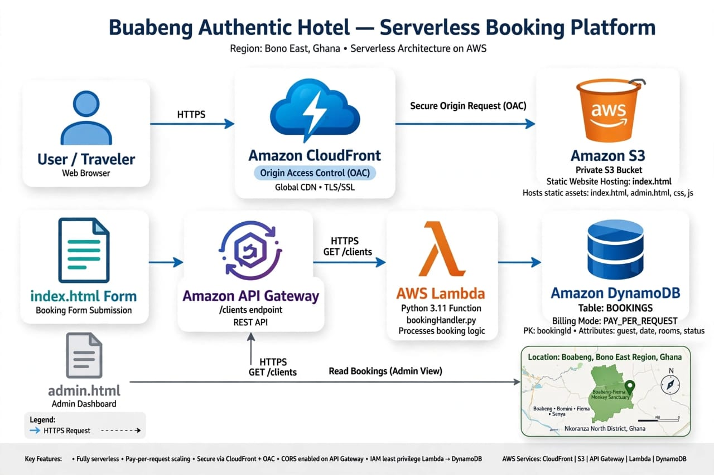

# Buabeng Authentic Hotel - Serverless Booking Platform on AWS

**Live Demo:** https://buabengauthentichotel.com
**Architecture:** S3 + CloudFront (OAC) + Route53 + ACM + API Gateway + Lambda + DynamoDB
**IaC:** CloudFormation | **Cost:** ~$2-5/month | **Region:** us-east-1

## Problem
Local hotel in Apedwa Akim, Ghana needed a cheap, secure, scalable website to capture bookings without monthly cPanel hosting. Built serverless to eliminate server management.

## Architecture


**Flow:**
1. User -> Route53 (buabengauthentichotel.com) -> CloudFront (HTTPS, ACM cert in us-east-1)
2. CloudFront -> Private S3 Bucket via Origin Access Control (OAC) - No public access
3. Booking Form (index.html) -> POST to API Gateway /clients -> SaveLambda -> DynamoDB
4. Admin Dashboard (admin.html) -> GET /clients -> ReadLambda -> DynamoDB

## AWS Services Used & Why
- **S3:** Static hosting - $0.50/mo vs EC2 $10/mo, BlockPublicAcls = true
- **CloudFront + OAC:** Global CDN, HTTPS, OAC is new best practice replacing OAI
- **Route53 + ACM:** Custom domain buabengauthentichotel.com + free SSL (cert must be in us-east-1 for CloudFront)
- **API Gateway + Lambda:** Serverless REST API, auto-scales, no server patching, 2 functions for least privilege
- **DynamoDB PAY_PER_REQUEST:** Serverless NoSQL, scales to 0 cost when idle
- **CloudFormation:** Full Infrastructure as Code, reproducible, no manual console clicks
- **IAM Role:** Least privilege - only PutItem, Scan, GetItem on one table

## How to Deploy
```bash
aws cloudformation deploy \
  --template-file cloudformation/buabeng-full-stack.yaml \
  --stack-name buabeng-hotel-prod \
  --capabilities CAPABILITY_IAM \
  --parameter-overrides ProjectName=buabeng-hotel

# Get outputs
aws cloudformation describe-stacks --stack-name buabeng-hotel-prod --query "Stacks[0].Outputs"

# Upload frontend - replace BUCKET_NAME from output
aws s3 sync frontend/ s3://BUCKET_NAME/ --delete

Security Best Practices Implemented
S3 private, BlockPublicAcls
Only CloudFront can read via OAC + BucketPolicy with SourceArn condition
IAM least privilege
HTTPS enforced via CloudFront + ACM
No hardcoded Account IDs, API keys, or passwords in repo - uses REPLACE placeholders
Environment variables for table name, not hardcoded

Future Improvements
Add Cognito for admin auth instead of client-side password
Add WAF on CloudFront
Add email notification via SES on new booking

Author
Aspiring AWS Solutions Architect | Ghana 